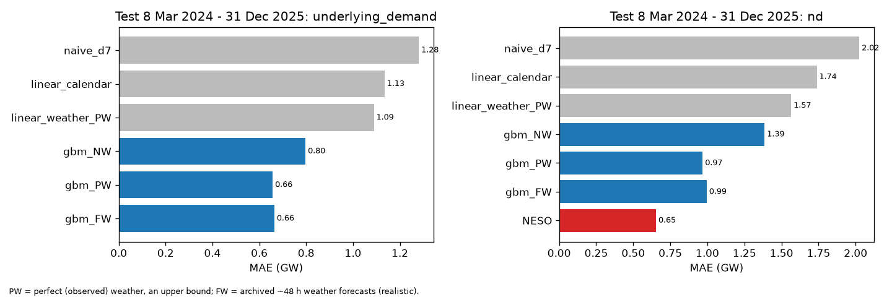
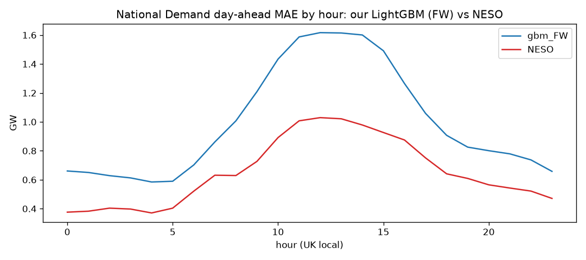
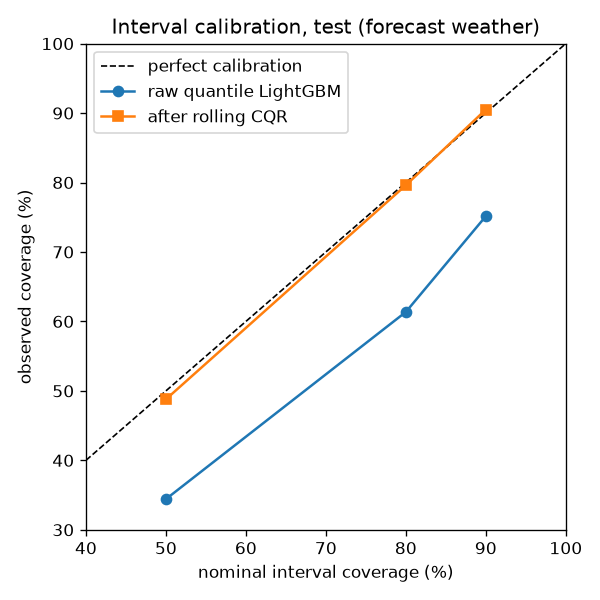
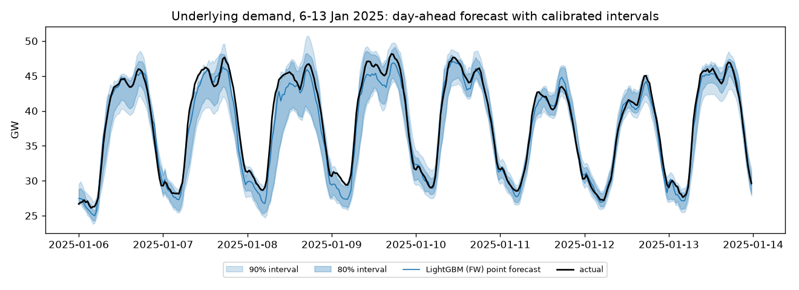

# Forecasting report: Batch 4 (Steps 24–30)

_Energy Futures 2050 · 18 Nov 2026 · validation run `20261118-1639-61745db`, test run `20261118-1641-61745db` · protocol pre-registered in commit `61745db` (D-023) before the test set was unsealed._

## Summary

A LightGBM day-ahead model with realistic (forecast) weather forecasts GB underlying demand with a mean absolute error of **664 MW (2.2%)** on the held-out period 8 Mar 2024 – 31 Dec 2025. That is **48% lower than the weekly naive** and **39% lower than the best linear baseline**. Calibrated quantile forecasts hit their nominal coverage on the test period (90% interval: 90.5%).

**Our model does not match NESO's operational forecast.** On National Demand, NESO's day-ahead MAE is **653 MW** against our **995 MW**. NESO is better in every hour and every month, and we beat it on only 22% of days.

## Task and data

- Day-ahead, half-hourly. Forecasts are issued 09:00 UK time on D-1 for every settlement period of local day D (D-017). NESO publishes at about 09:30–09:45, so it has slightly more information than our model.
- Main target: underlying demand = ND + embedded solar + embedded wind (D-010). Benchmark target: ND, because that's what NESO forecasts.
- Data v1: NESO historic demand 2009–2025, Open-Meteo ERA5 weather (6 cities, equal weights), Open-Meteo archived ~48 h forecasts (`previous_day2`, from Feb/Mar 2024), NESO day-ahead forecast performance file.
- Splits: train from 2009 · validation 2023 (monthly expanding-window refits) · test 2024–2025, opened once.

## Features (Step 24)

Calendar (local half-hour slot, weekday, month, E&W bank holidays, Christmas period, day-of-year cycle) · demand known at issue time (same slot on D-2, D-7 and D-14; D-2 mean and max; D-7 mean; the latest 24 h mean) · weather at the target time (temperature, 24 h smoothed temperature, heating and cooling degrees, wind, cloud, solar radiation).

Leakage is tested: every demand feature's source data is published before the issue time, including across all four clock changes in 2023–2024.

Weather settings: **PW** observed weather (upper bound, not deployable) · **NW** no weather · **FW** archived forecasts fed to a model trained on observed weather (realistic).

## Model selection on validation 2023 (Step 25)

| Training start | LightGBM NW MAE (MW) | LightGBM PW MAE (MW) |
| --- | --- | --- |
| **2009** (chosen) | **768** | **597** |
| 2016 | 792 | 620 |
| 2020 | 824 | 637 |

Unlike the linear models (EXP-001), LightGBM does best with the longest history: the recent-level features absorb the downward trend in demand. Hyper-parameters were fixed in advance, not tuned.

## Test results, 8 Mar 2024 – 31 Dec 2025 (Step 26)

| Model | Underlying demand MAE (MW) | MAPE % | High-demand MAE | ND MAE (MW) |
| --- | --- | --- | --- | --- |
| naive_d7 | 1,281 | 4.20 | 2,606 | 2,024 |
| linear_calendar | 1,135 | 3.86 | 2,022 | 1,738 |
| linear_weather_PW | 1,089 | 3.76 | 1,736 | 1,565 |
| LightGBM NW | 797 | 2.62 | 1,348 | 1,386 |
| LightGBM PW (upper bound) | 657 | 2.20 | 947 | 968 |
| **LightGBM FW (realistic)** | **664** | **2.22** | **981** | **995** |
| **NESO operational** | — | — | — | **653** |

- Realistic weather forecasts cost only about 1% of accuracy compared with perfect weather (664 vs 657 MW). The forecast GB temperature error is 0.66 °C.
- Weather is worth about 17% of the error (NW 797 → FW 664 MW), and about 27% at high demand.
- ND is harder than underlying demand (995 vs 664 MW) because it nets off solar output, which our model only sees through solar radiation at 6 cities.

## Where the errors are (Step 27): LightGBM FW, underlying demand

| Segment | MAE (MW) | Half-hours | naive_d7 MAE |
| --- | --- | --- | --- |
| All | 664 | 31,152 | 1,281 |
| Weekdays / weekends | 661 / 642 | 22,032 / 9,120 | 1,245 / 1,155 |
| Bank holidays | 1,039 | 720 | 3,983 |
| Christmas period | 1,120 | 864 | 3,782 |
| Clock-change weeks | 757 | 1,344 | 1,371 |
| Cold (< 3 °C) | 874 | 1,771 | 3,000 |
| Hot (> 22 °C) | 558 | 728 | 1,026 |
| Top-5% demand | 1,000 | 1,594 | 2,750 |
| Spring / autumn transitions | 706 / 699 | 5,516 / 5,860 | 1,402 / 1,478 |

The weakest areas are holidays, Christmas, cold spells and peaks: the conditions that matter most for flexibility planning. Error during cold spells is 32% above average.

**Against NESO:** the gap is present at every hour, including overnight (≈0.65 vs ≈0.38 GW), so it is not only about solar. It is widest around midday, when embedded solar is highest (1.61 vs 0.97 GW when solar exceeds 5 GW).

Likely causes, **not tested here**: NESO has far richer weather inputs (many sites, ensembles), dedicated embedded-solar and wind forecasting, demand data up to its later publication time, and forecaster expertise. Our model uses 6 equally weighted cities and no solar-generation forecast.

## Uncertainty (Steps 28–29)

Quantile LightGBM (5–95%) with quarterly refits, then rolling conformal calibration (CQR) using only past out-of-sample scores (365-day window).

| Interval | Raw coverage, 2023 → test | CQR coverage, 2023 → test | CQR mean width, test (MW) |
| --- | --- | --- | --- |
| 50% | 36.2 → 34.4 | 53.7 → **48.8** | 1,064 |
| 80% | 63.6 → 61.4 | 82.9 → **79.6** | 2,140 |
| 90% | 77.5 → 75.2 | 92.5 → **90.5** | 2,946 |

Pinball loss on test: 206 raw → 195 MW after CQR. Raw quantile models are badly overconfident; CQR fixes this, at the cost of wider intervals. Coverage is averaged over the period. Conditional coverage (for example during cold spells) is **not yet assessed**.

## Limitations

1. No NESO comparison exists for underlying demand, because NESO doesn't publish that forecast.
2. Weather inputs are 6 equal-weight cities (D-012). Forecast archives only start in 2024, so the realistic setting can't be tested before then.
3. Single fixed hyper-parameter set; no deep-learning or ensemble comparison.
4. The CQR window mixes 2023 perfect-weather scores into early-2024 calibration; coverage was still close to nominal.
5. ND outturn in the NESO file is initial outturn; it differs from our settled ND by about 55 MW on average.

## Decision for the next phase (Step 30)

- **Use LightGBM FW + rolling CQR quantiles (underlying demand) as the forecast feeding Engines 3–4.** It is the best realistic model we have, and its intervals are calibrated.
- **Do not claim parity with operational forecasting.** The defensible claim is "an open, reproducible probabilistic forecaster that is 39–48% better than standard baselines and calibrated, but about 50% worse than NESO on ND".
- Improvements worth testing later, ranked by expected effect: population-weighted multi-site weather; an embedded-solar generation forecast; holiday-specific handling; conditional calibration for cold spells.
