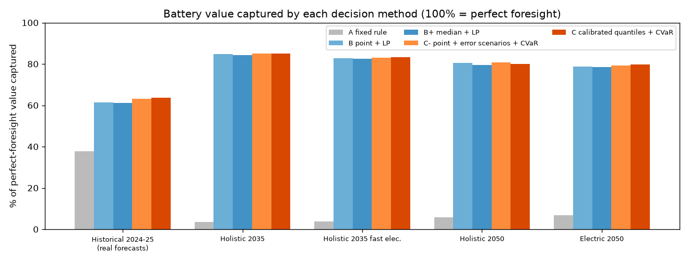
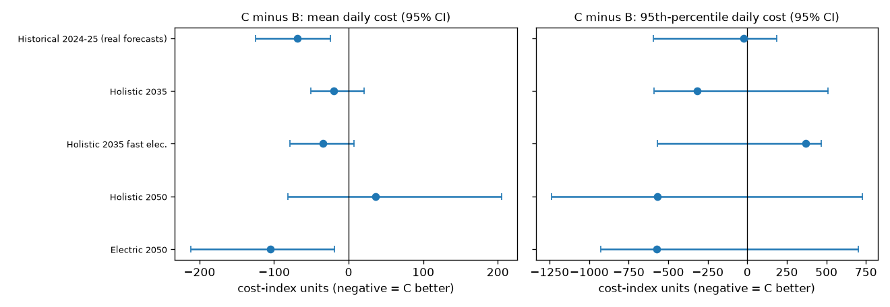

# Optimisation report: Batch 6 (Steps 37–42)

_Energy Futures 2050 · 19 Nov 2026 · protocol pre-registered in commit `92fd643` (`configs/optimisation.yaml`, D-035) before any run · `uv run python -m energy_futures.experiments.optimisation historical|future|report`._

## Answer to the research question (so far)

**Uncertainty-aware optimisation (C) gave a small, consistent improvement in average outcomes, but no statistically detectable improvement in robustness.**

The pre-registered criteria H1 and H3 are met on their point estimates. But every 95%-confidence interval for the tail metric (95th-percentile daily cost) includes zero. The effects that clearly matter are much larger:
1. **Optimising at all:** the LP methods capture 61–85% of perfect-foresight value; the fixed rule captures 4–38%.
2. **Forecast error:** the remaining 15–39% gap to perfect foresight.

Against these, risk-aware decision-making adds 0–2.5 percentage points.

## Experiment

- **Decision:** at 09:00 on D-1, commit tomorrow's charge/discharge schedule for one aggregated GB battery. It is executed against realised load. Each day starts and ends at 50% charge. Round-trip efficiency 0.88 (assumption).
- **Stylised cost index (not £):** daily peak (MW) + 2 × energy above a stress threshold (MWh) + a small throughput cost.
- **Arms (D-002):** none · A seasonal-naive + fixed threshold rule · B LightGBM point + LP · B+ calibrated median + LP · C− point forecast × unconditional error quantiles + CVaR LP · C calibrated conditional quantiles (CQR) + CVaR LP · oracle (perfect foresight). Risk objective: 0.5·mean + 0.5·CVaR₀.₉₀.
- **Setting H (historical):** 8 Mar 2024 – 31 Dec 2025 (663 days), real day-ahead forecasts. Underlying demand; FES 2024 battery 6.8 GW / 9 GWh; threshold 43.3 GW (2023 p99).
- **Setting F (future):** FES 2035/2050 net demand (demand − wind − solar − nuclear), weather year 2022 (includes the cold, still week), FES battery sizes (29.8 GW / 43 GWh in 2035; 39–40 GW / 59–60 GWh in 2050). Synthetic forecasts reuse real 2024–25 LightGBM errors and CQR widths. Wind and solar are treated as perfectly forecast (optimistic; D-037).

## Results

**Setting H, central case** (cost index; MW / GWh):

| Arm | Mean daily cost | p95 daily cost | Total shortfall (GWh) | Max load after battery (MW) | Perfect-foresight value captured |
| --- | --- | --- | --- | --- | --- |
| none | 36,739 | 46,283 | 305.1 | 48,141 | 0% |
| A fixed rule | 35,665 | 43,131 | 202.3 | 47,097 | 37.7% |
| B point + LP | 34,990 | 42,731 | 150.8 | 46,909 | 61.3% |
| B+ median + LP | 34,992 | 42,616 | 152.2 | **48,337** | 61.2% |
| C− error scenarios + CVaR | 34,940 | 42,754 | 141.6 | 46,806 | 63.1% |
| **C calibrated quantiles + CVaR** | **34,921** | 42,709 | **140.7** | 46,512 | **63.7%** |
| oracle | 33,886 | 41,533 | 119.3 | 45,911 | 100% |

Note: on one day, B+ charged during an under-forecast period and pushed the annual maximum *above* the no-battery case (48,337 vs 48,141 MW). Point-forecast scheduling can make the worst hour worse.

**Pre-registered tests:**

| Test | Point estimate | 95% CI (7-day block bootstrap) | Verdict |
| --- | --- | --- | --- |
| H1: C vs B, p95 daily cost (historical) | −21 | [−596, +186] | Met on point estimate; **not significant** |
| H1: C vs B, total shortfall (historical) | −10.1 GWh (−6.7%) | [−24.3, +0.3] GWh | Met; borderline |
| Mean cost sub-condition (≤ B + 1%) | −69 (C cheaper) | [−125, −25] | Met; CI excludes 0 (**exploratory secondary** — see statistical_tests.md §3.4; not the H1 verdict) |
| H3: C beats B on p95 in ≥ 3 of 4 future cases | 3 of 4 (fails: Holistic 2035 fast electrification) | all 4 CIs include 0 | Met on point estimates; **not significant** |

**H2, where C's advantage comes from (historical mean daily cost):**
- C vs B+ (same probabilistic model, risk-aware vs deterministic use): −71 [−158, −16]. **The risk-aware decision rule is what helps.**
- C vs C− (conditional calibrated quantiles vs one unconditional error distribution): −19 [−47, +13]. **Conditional uncertainty adds no detectable value** over a simple error distribution.

**Future cases** (perfect-foresight value captured; A / B / C): Holistic 2035 3.5 / 84.8 / 85.1% · Holistic 2035 fast electrification 3.7 / 82.8 / 83.3% · Holistic 2050 5.7 / 80.4 / 80.0% · Electric Engagement 2050 6.8 / 78.8 / 79.9%. The fixed rule nearly fails in the future, because net demand peaks move with wind and solar. Worst-day costs are almost identical across arms (cold, still week): **a battery sized for daily cycling cannot cover multi-day energy deficits** (consistent with Batch 5).

## Sensitivity (Step 42, setting H)

| Variant | B captured | C captured | C − B: p95 | C − B: shortfall (GWh) | C − B: mean |
| --- | --- | --- | --- | --- | --- |
| Central | 61.3% | 63.7% | −21 | −10.1 | −69 |
| Battery ×0.5 | 53.2% | 57.7% | −275 | −16.3 | −92 |
| Battery ×2 | 69.5% | 70.8% | −72 | −5.3 | −50 |
| μ = 0.5 / μ = 10 | 57.5 / 70.9% | 59.5 / 74.7% | −59 / −21 | −10.9 / −10.3 | −47 / −194 |
| α = 0.5 / α = 0.95 | 61.3 / 61.3% | 64.8 / 63.7% | −137 / −36 | −14.1 / −10.8 | −100 / −69 |
| Threshold = 2023 p95 | 71.9% | 76.1% | −1,014 | −48.9 | −192 |

C is ahead of B in **all 8 variants** on every metric. The advantage grows when the battery is scarce (×0.5) and when stress events are more frequent (lower threshold). In other words, uncertainty-awareness matters most where flexibility is energy-constrained.

## Limitations

1. Stylised cost index: no prices, network or degradation costs. The battery cycles about 2.7 times a day; degradation is not modelled.
2. One aggregated battery with no network constraints; LDES and interconnectors are excluded.
3. The future setting ignores wind and solar forecast errors (optimistic) and reuses 2024–25 demand-error patterns.
4. Comonotonic scenarios (D-036) can over-state joint extremes.
5. One weather year in the future setting; the multi-day cold week dominates the worst-day statistics.
6. Daily independence: no state of charge is carried between days. This is a limitation for multi-day events.

## Conclusion for the KTP narrative

The defensible claims:
- "Moving from rule-based to forecast-driven optimisation roughly doubles the battery value captured (38% → 61% of perfect foresight on real 2024–25 data)."
- "Uncertainty-aware scheduling adds a small, consistent gain (+2.4 points; average-cost gain significant as an **exploratory secondary finding**). Its tail-risk benefit is not statistically demonstrated with 22 months of data, but it grows when storage is scarce."

**Not defensible:** "uncertainty-aware AI makes planning substantially more robust."
