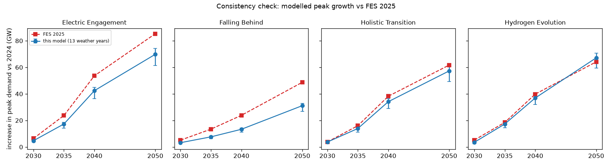
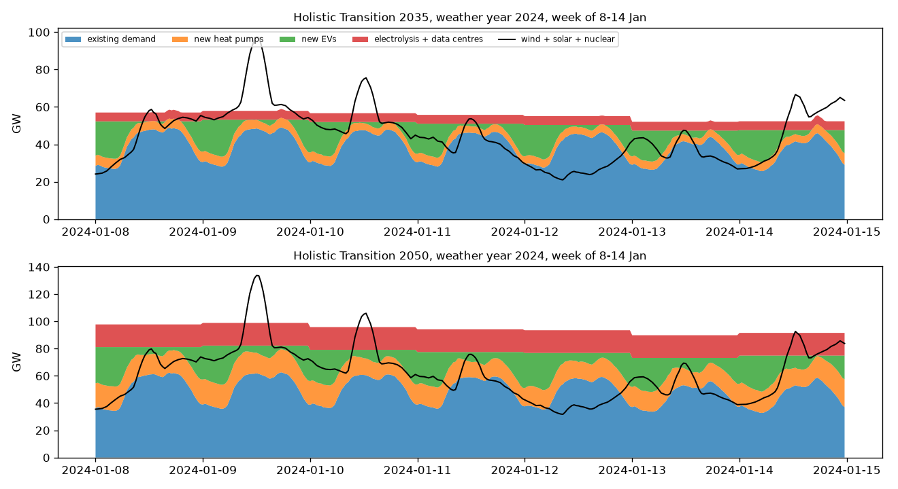

# Scenario report: Batch 5 (Steps 31–36)

_Energy Futures 2050 · 19 Nov 2026 · 312 runs (4 FES pathways × 4 years × 13 weather years + sensitivities) · `uv run python -m energy_futures.experiments.scenarios` · inputs and assumptions: `docs/assumptions.md`._

## Summary

All results below are **simulated consequences of FES 2025 pathways under stated assumptions, not predictions**. Under Holistic Transition, modelled GB peak demand rises by a median **14 GW by 2035 and 57 GW by 2050**, against FES's 16 GW and 62 GW. Across 13 historical weather years, peak *net* demand (after wind, solar and nuclear) reaches a median of **46 GW in 2035 and 77 GW in 2050**.

The most demanding conditions are a cold, still week like **9–15 Dec 2022**. In it, a 2050 Holistic system needs about **10 TWh** from storage, dispatchable plant and imports in seven days. That is about 36× the battery and long-duration storage energy capacity FES assumes for 2050 (0.28 TWh).

The **largest single lever** is EV charging behaviour: if 30% of EV charging is unmanaged, the 2035 median peak rises by 11 GW.

## Consistency with FES (Step 36)

| Pathway | Year | Our peak increase, median [range] (GW) | FES peak increase (GW) | Our HP at peak / FES (GW) | Our EV at peak / FES (GW) |
| --- | --- | --- | --- | --- | --- |
| Holistic Transition | 2035 | 13.9 | 16.0 | 5.8 / 8.0 | 0.0 / 4.4 |
| Holistic Transition | 2050 | 57.3 | 61.7 | 22.0 / 29.0 | 24.1 / 8.3 |
| Electric Engagement | 2035 | 17.3 | 23.7 | 6.2 / 10.1 | 0.0 / 6.0 |
| Electric Engagement | 2050 | 69.8 | 85.3 | 23.0 / 36.1 | 27.0 / 12.8 |
| Hydrogen Evolution | 2050 | 67.1 | 64.1 | 20.0 / 32.5 | 22.9 / 13.1 |
| Falling Behind | 2050 | 31.1 | 48.7 | 7.2 / 12.2 | 24.7 / 14.3 |

(Weather-year ranges: `outputs/scenarios/summary_by_pathway_year.csv`.)

**Reading the check:**
- Holistic Transition and Hydrogen Evolution peak growth is within about 13% of FES (Holistic: 13% under in 2035, 7% under in 2050). Electric Engagement and especially Falling Behind are under-stated (by 18% and 36% in 2050).
- Heat pumps at peak run about 60–75% of FES's figure, partly because commercial heat pumps have no separate shape (A5) and partly because FES's peak is an average-cold-spell diversified estimate.
- **The EV component does not match FES.** Before about 2040, idealised daily valley-filling puts zero EV load at the peak. After 2040, EV energy is large enough to flatten whole days, so EV load at the peak (21–27 GW) exceeds FES (8–14 GW). This is a known artefact of A6, not a finding.
- Energy is conserved exactly: the annual demand change equals the FES change in every run (tested).

## Future conditions (central assumptions; medians over 13 weather years)

| Pathway | Year | Demand (TWh) | Peak demand (GW) | Peak net demand (GW), median / worst | Surplus before export/storage (TWh) |
| --- | --- | --- | --- | --- | --- |
| Holistic Transition | 2035 | 406 | 60.2 | 46.0 / 48.7 | 186 |
| Holistic Transition | 2050 | 677 | 102.6 | 77.2 / 82.2 | 178 |
| Electric Engagement | 2050 | 757 | 115.1 | 83.1 / 89.6 | 152 |
| Hydrogen Evolution | 2050 | 769 | 112.5 | 90.0 / 95.2 | 96 |
| Falling Behind | 2050 | 531 | 77.0 | 59.3 / 61.4 | 119 |

Large surpluses mean wind and solar energy that must be exported, stored or curtailed. FES's own exports, curtailment and storage consumption are of the same order.

## Stress tests (Step 35)

| Stress | Pathway, year | Peak demand (GW) | Peak net (GW) | Net energy to cover in window (TWh) | Wind + solar share of demand |
| --- | --- | --- | --- | --- | --- |
| Cold, still week (9–15 Dec 2022) | Holistic 2035 | 62.2 | 46.3 | 4.9 | 44% |
| Cold, still week | Holistic 2050 | 108.2 | 81.6 | 10.1 | 32% |
| Cold, still week | Electric Eng. 2050 | 121.4 | 89.0 | 11.4 | 27% |
| Cold, still week | Hydrogen Evol. 2050 | 117.9 | 94.7 | 12.5 | 26% |
| Low-renewable fortnight (2–15 Sep 2014) | Holistic 2050 | 72.4 | 53.3 | 8.9 | 49% |
| Fast electrification (2035 with 2040 EV/HP), cold week | Holistic 2035 | 78.4 (+16.2) | 62.1 (+15.8) | 7.5 (+2.6) | 35% |

**Sensitivities (Holistic, median peak demand, GW):**

| Year | Central | 30% unmanaged EV charging | 20% hot-water share for heat pumps |
| --- | --- | --- | --- |
| 2035 | 60.2 | 71.2 | 59.4 |
| 2050 | 102.6 | 119.3 | 99.8 |

## What this simulation can and cannot establish (Step 36)

**Can:** show how FES pathway assumptions translate into half-hourly demand, net-demand, peak and surplus patterns across 13 real weather years. Show which drivers move peaks most (EV charging behaviour ≫ heat-pump hot-water share). Identify stress windows from observed weather. Give Batch 6 consistent, energy-conserving inputs.

**Cannot:**
1. Predict the 2050 system. There is no accuracy metric for 2050.
2. Assess security of supply: no dispatchable plant, interconnector availability, de-rating or network constraints are modelled.
3. Represent offshore wind variability faithfully (A8).
4. Represent realistic smart charging. EV results are bracketed by the central and sensitivity cases, not estimated (A6).
5. Capture weather patterns outside 2013–2025 or climate change (no 1-in-20 winter).

## Implications for Batch 6

- The flexibility question is concentrated in **cold, still weeks** and **EV charging management**. Both are suited to the storage and demand-flexibility optimisation in Batch 6.
- FES storage energy (0.28 TWh in 2050) is small next to a 10 TWh cold-week need. Battery value will come from daily peak and ramp management, not multi-day cover. Batch 6 should measure that, not assume it.
- Batch 6 should replace the idealised EV assumption (A6) with optimised EV flexibility under charging constraints.
